# Toy Haven – Online Toy & Collectibles Marketplace

A school project (2025). Toy Haven is a multi-vendor online marketplace where buyers can shop for toys and collectibles, sellers can manage their own shops, and an admin approves seller accounts.

*These are the early wireframes. The project was first called **Toy Shap** and was later renamed **Toy Haven**.*

## My Role
**Project Leader & UI Designer** of a team project. My work was:

- Led the team in building a multi-vendor toy marketplace with buyer, seller, and admin roles
- Made the data flow diagrams (DFDs) for the system
- Made the wireframes and icons in Figma and Canva
- Built front-end pages using JavaScript, HTML, and CSS

**Tools** → Figma, Canva, JavaScript, HTML, CSS

## Wireframes

**Sign Up**
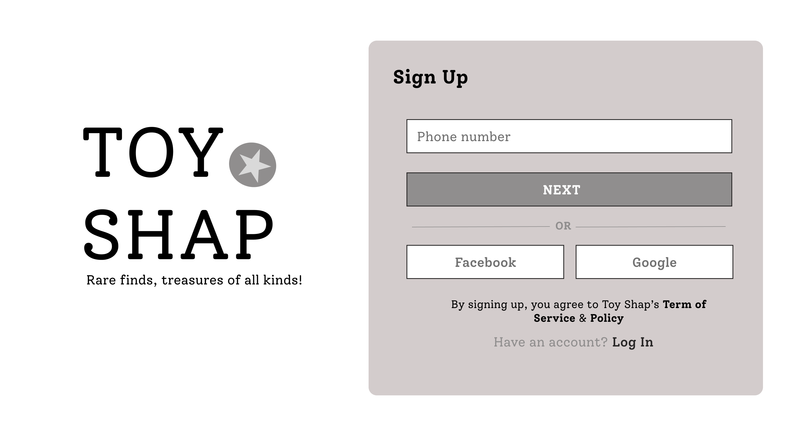

**Log In**
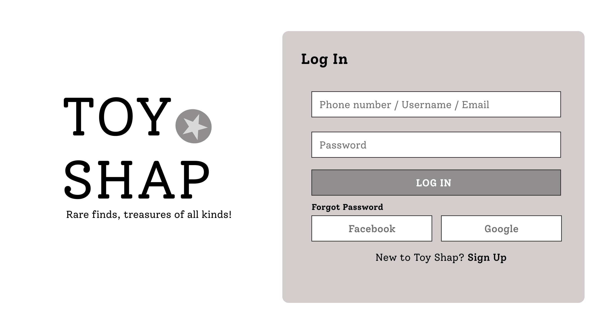

**Home**
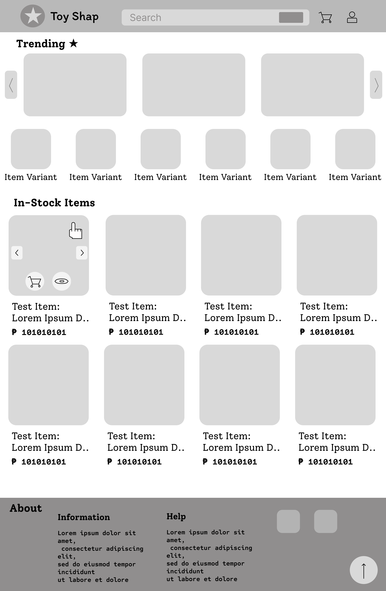

**Search Results**
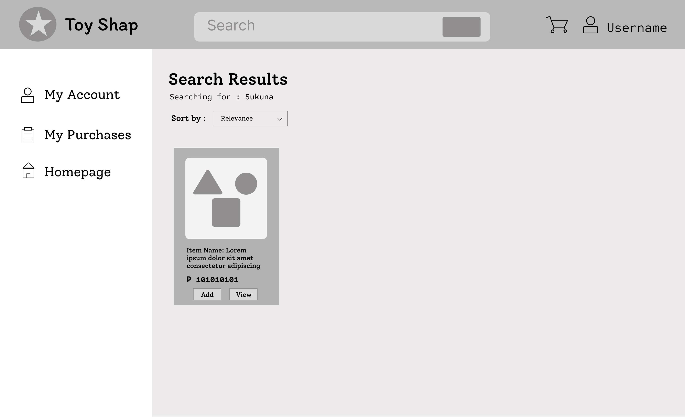

**Product Page**
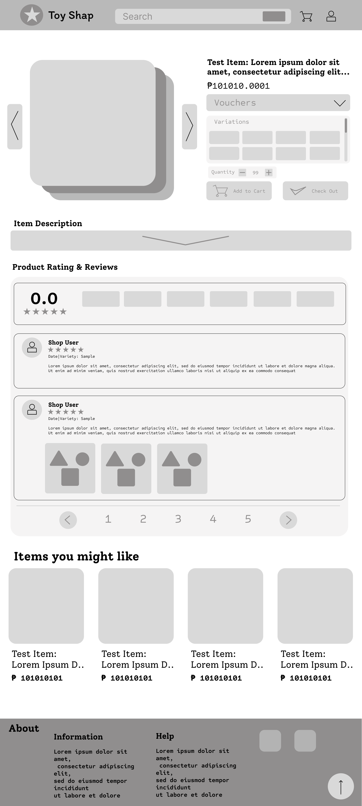

**Shop Page**
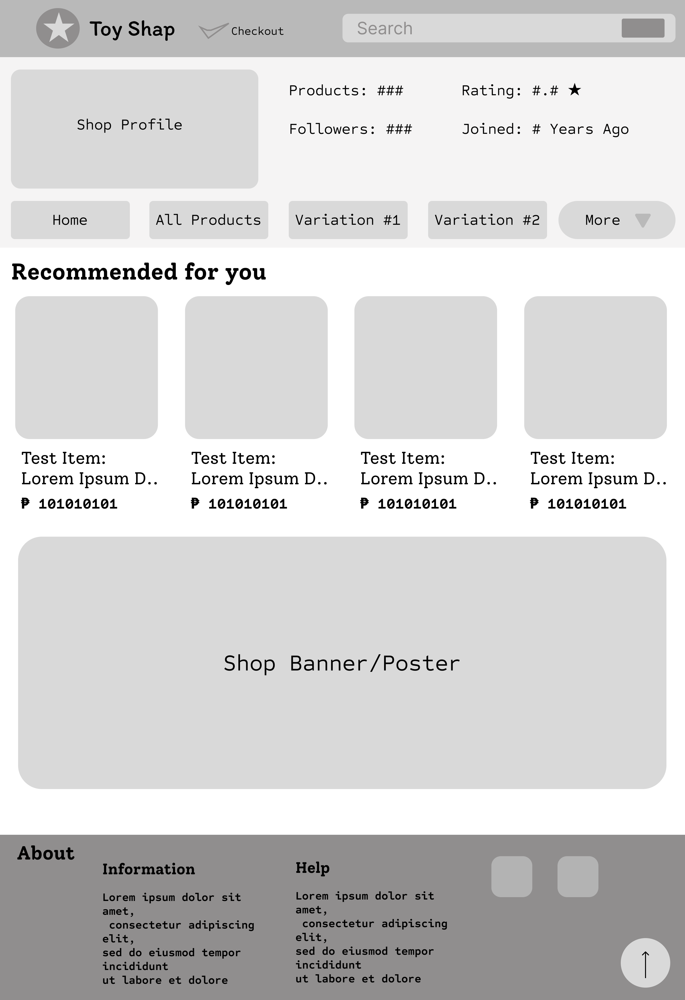

**Shopping Cart**
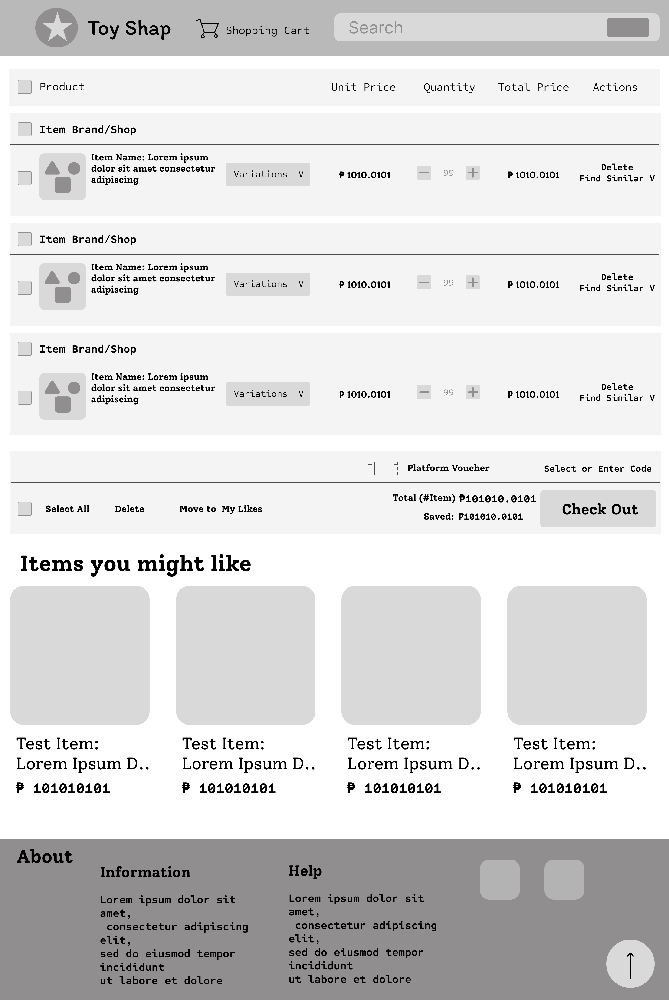

**Checkout**
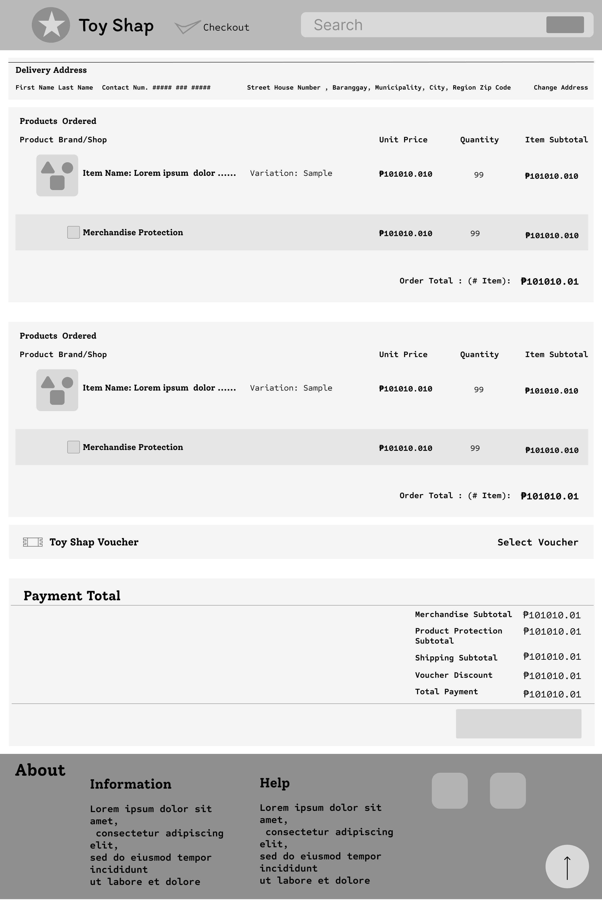

**Recent Orders**
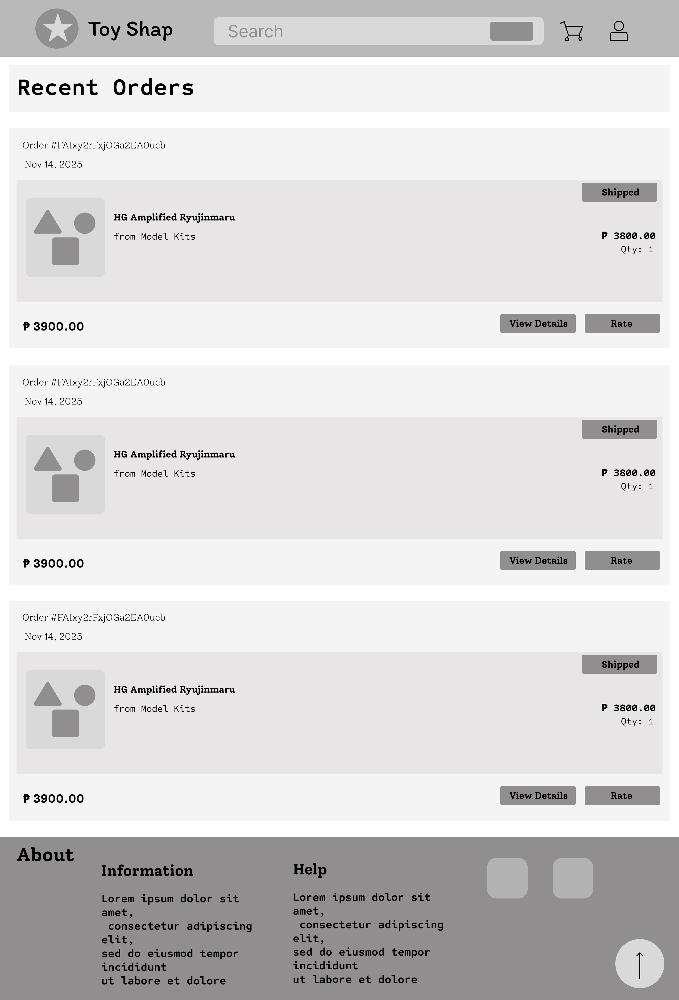

**Order Details**
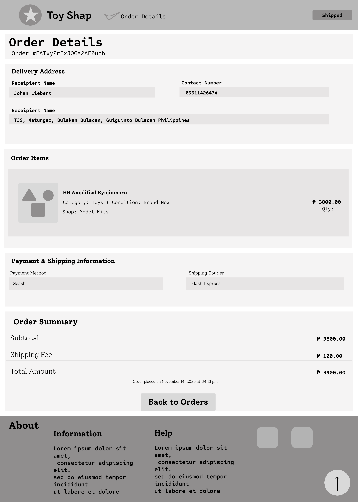

**Rate Your Purchase**
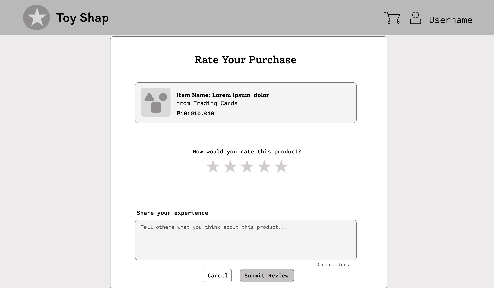

**My Profile**
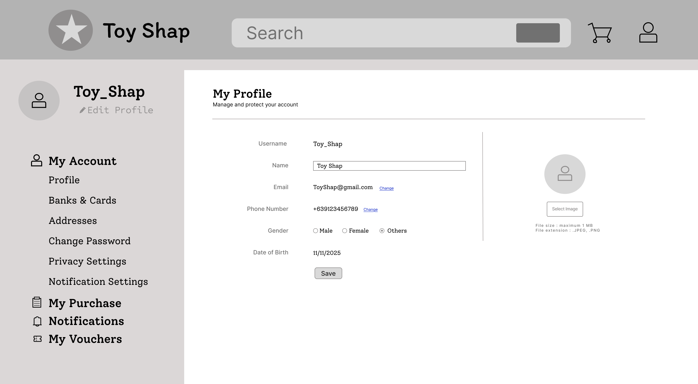

## Data Flow Diagrams

**Context Diagram**
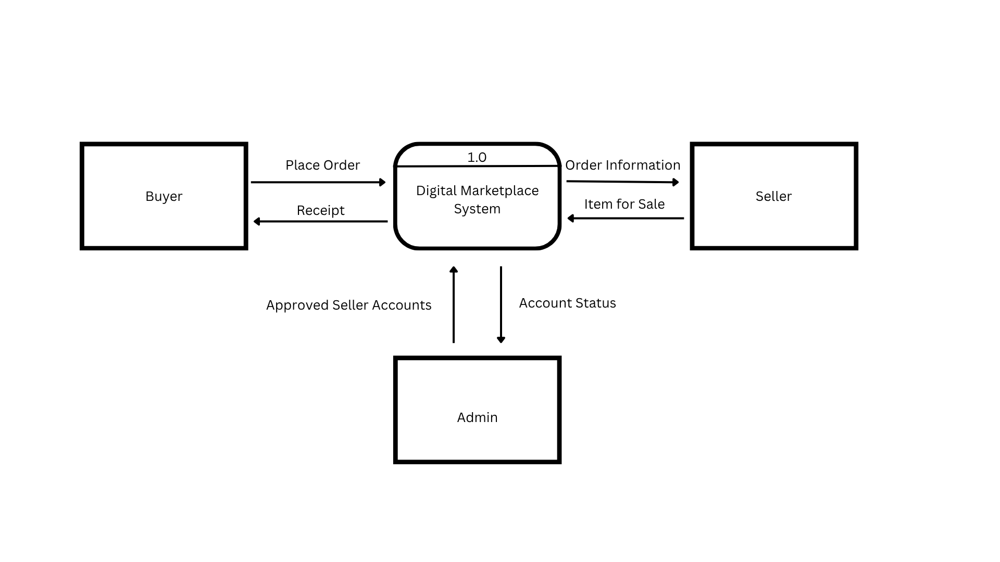

**Level 1 DFD**
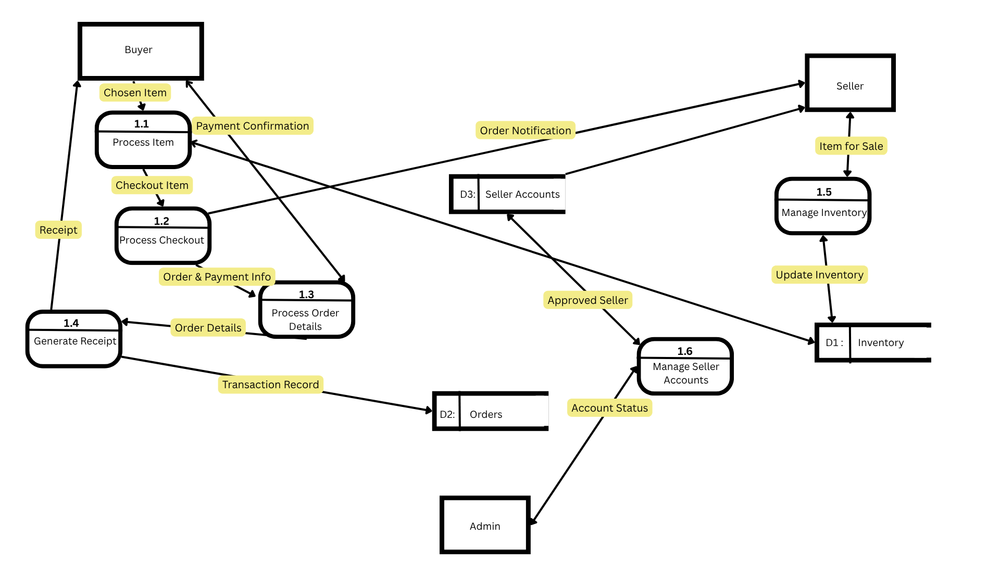
